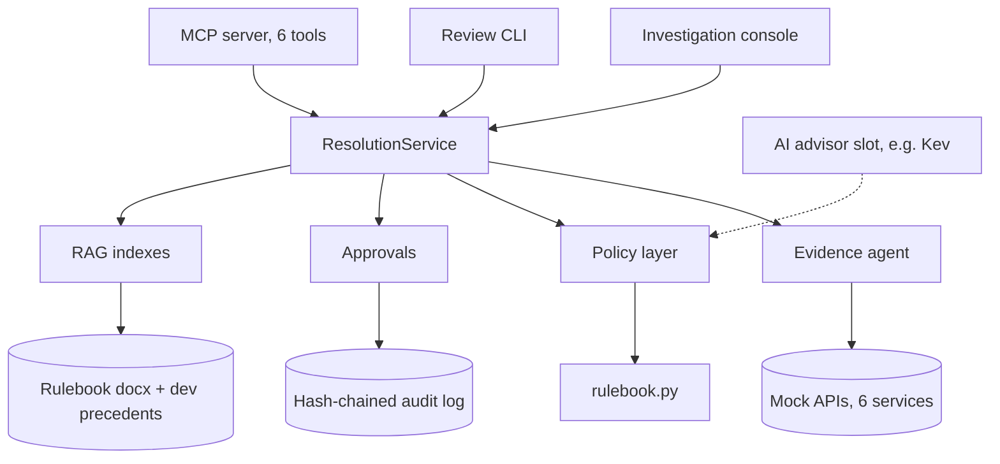
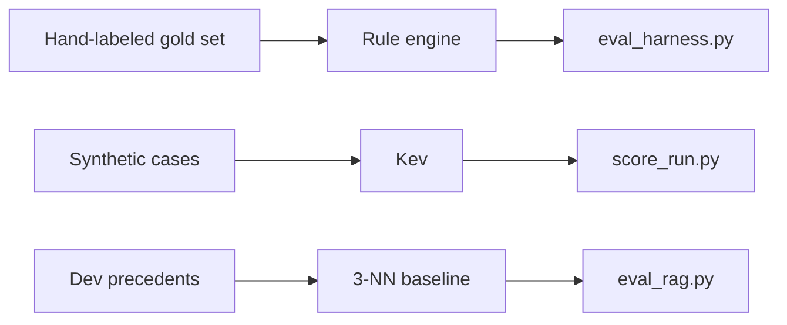

# Resolution Center

A learning project that builds an AI-assisted **dispute resolution** system for payments-style cases, end to end: evidence gathering, a deterministic policy layer, human approval with an audit trail, retrieval, an MCP server, a reviewer console, and an evaluation harness for testing models against labeled data.

It covers two case types, **INR** (Item Not Received) and **SNAD** (Significantly Not as Described).

> **Status:** learning project, not production software. All data is synthetic, all policy is invented, and "executing" a decision is a mock that moves no money. This is an independent personal project. It is not affiliated with, derived from, or based on any employer's systems, policies or data.

## Design principle

> The AI recommends and explains. Deterministic rules enforce policy. Authorized humans execute consequential actions.

- `rulebook.py` is the single source of truth for outcomes and for gold labels. A model's recommendation is recorded and compared with the rule result, never obeyed.
- Approving a refund or denying a buyer always needs a human. Only a clean request-for-evidence can go out automatically.
- Every state change is written to an append-only, hash-chained audit log.
- The MCP server deliberately has no tool that approves, overrides or executes anything.
- The test split is sealed. Tuning happens on dev data only.

## Architecture



The dashed arrow marks the integration point for a model's recommendation. It is **not wired yet**; models are currently evaluated offline.

Evaluation side:



### How a case flows

1. A case enters through the console, the CLI or the MCP server.
2. `ResolutionService` asks the **evidence agent** to collect facts from six mock backends (order, tracking, dispute, merchant, buyer history, SNAD claim). The agent owns retries (one retry for transient failures), a 12-call budget per case and a trace. The planner is pluggable (`plan_next(state)`); the default is deterministic.
3. The **policy layer** validates the case (malformed input escalates), applies the rulebook, and decides whether a human must review.
4. The decision is submitted to the **approval queue**. Reviewers approve, override or reject; only then can the mock execution run. Senior reviewers are required for escalations, high-value cases and overrides to approve-the-buyer.
5. **RAG indexes** (policy, guidance, precedents) supply context for the reviewer. They do not decide outcomes.

## The rulebook

Outcomes: `APPROVE_BUYER`, `DENY`, `REQUEST_EVIDENCE`, `ESCALATE`.

Rules are applied in order: global rules first, then the INR or SNAD rules, then a default of `REQUEST_EVIDENCE`.

| Group | Rules |
|---|---|
| Global | G1 filing window, G2 duplicate, G3 counterfeit claim, G4 high-value conflict, G5 abuse signal, G6 evidence conflict |
| INR | INR-1 to INR-7: too early, proven delivery, weak delivery proof, lost or returned, no tracking (silent or recent), transit length |
| SNAD | SNAD-1 to SNAD-6: missing evidence, wrong item, clear mismatch, buyer's remorse, damage, return gate |

Thresholds (180-day window, 7 and 14 days, 100 and 1,000 amounts, 3 prior disputes in 90 days, 0.7 AI confidence) are placeholders defined once at the top of `rulebook.py` and `policy.py`. The full prose version is in `Resolution Center — Dispute Rulebook v0.1.docx`, which `rag_indexes.py` reads directly, so keep the filename unchanged.

Not covered yet: partial refunds, unauthorized transactions, refund-not-received.

## Getting started

Requirements: Python 3.10 or newer. Everything uses the standard library except the MCP server, which needs the `mcp` Python SDK (the version that provides `mcp.server.mcpserver`).

```bash
pip install mcp            # only needed for mcp_server.py and test_mcp_server.py
```

Generate the synthetic data first. `data/` is git-ignored except for the hand-labeled gold files, because the same seed always produces identical files:

```bash
python generate_cases.py --n 300 --seed 42 --out data
```

Then run the tests (each file is also runnable under `pytest`):

```bash
python test_rulebook.py
python test_policy.py
python test_approvals.py
python test_evidence_agent.py
python test_rag.py
python test_eval_harness.py
python test_gold.py
python test_console.py
python test_mcp_server.py
```

### Investigation console

```bash
python console.py --port 8765        # then open http://127.0.0.1:8765
```

A local web UI with three views: cases, approval queue and audit log. It can analyze a case (gather evidence, decide, show reviewer context), run a what-if on a pasted case without saving anything, submit to the queue, and review or execute. It serves the dev and gold sets only, binds to localhost, and checks Host and Origin on every request. Reviewer names and roles are self-declared; there is no authentication.

### Review CLI

```bash
python review_cli.py queue [--status APPROVED]
python review_cli.py show CASE_ID
python review_cli.py approve CASE_ID --reviewer NAME [--role senior]
python review_cli.py override CASE_ID --reviewer NAME --outcome DENY --reason "..."
python review_cli.py reject CASE_ID --reviewer NAME --reason "..."
python review_cli.py execute CASE_ID --reviewer NAME
python review_cli.py verify            # checks the audit log hash chain
```

The audit log defaults to `audit/audit_log.jsonl`; set `RC_AUDIT_LOG` to use another file.

### MCP server

```bash
python mcp_server.py                   # stdio transport
```

Point any MCP client at that command. Tools: `list_cases`, `gather_evidence`, `decide_case`, `get_case_context`, `submit_for_approval`, `list_approval_queue`. Typical flow: list, decide, get context, submit. Approval and execution are human-only (console or CLI).

## Data and labels

| File | Contents |
|---|---|
| `data/cases_dev.jsonl`, `labels_dev.jsonl` | 90 synthetic cases for tuning, with rulebook labels |
| `data/cases_test.jsonl`, `labels_test.jsonl` | 210 synthetic cases, sealed until the setup is frozen |
| `data/gold_cases.jsonl`, `gold_labels.jsonl` | hand-written hard cases with human labels |

The synthetic files are not committed: `python generate_cases.py --n 300 --seed 42 --out data` recreates them exactly (verified by regenerating and comparing byte for byte). The gold files are hand-labeled and are committed. If you change the generator, the rulebook or the seed, the data changes and earlier results in `runs/` no longer correspond to it.

Cases and labels live in separate files so inputs can be given to a model without the answers. Labels carry `gold_outcome`, `gold_rule`, `scenario` and `is_hard`. Never pass those fields to a model.

The synthetic cases come from 38 scenario templates, each stating the outcome and rule it should trigger; the generator asserts the labeler agrees. About half are "hard" (boundary values, unknown fields, contradictory evidence).

**Gold set workflow** (labels stay blind to the rulebook):

```bash
python make_gold_cases.py            # drafts hard cases and a blank label sheet
# fill in gold/label_sheet.csv by hand, before looking at rulebook output
python gold_tools.py check           # validate the sheet
python gold_tools.py compare         # run the rulebook, write gold/disagreements.csv
python gold_tools.py freeze          # write data/gold_labels.jsonl once disagreements are resolved
```

## Evaluation

```bash
python eval_harness.py --system rulebook          # rule engine on the gold set
python eval_harness.py --system knn               # 3-NN over dev precedents
python eval_harness.py --predictions runs/<file>.jsonl --labels dev
python eval_rag.py                                # retrieval quality on dev
```

Metrics include accuracy with Wilson intervals, per-class precision and recall, wrong refunds, wrong denials, missed escalations, calibration, and the share of cases routed to a human. With small n, read the intervals, not the point estimates.

### Testing a model: Kev

[Kev](https://github.com/jaredpalmer/kev) is a small open decision model (a LoRA adapter and a pointer-style head on a Qwen base) that scores a fixed set of options and returns probabilities. It is run through its own server, not a generic chat runtime.

```bash
# in a clone of the Kev repo, with a Python version it supports
uv sync --extra serve
uv run --no-python-downloads --extra serve python -m kev.serve --run jaredpalmer/kev-0.8b@v1.0 --port 8009

# in this repo
python run_kev.py --limit 5                        # smoke test
python run_kev.py                                  # structured fields only
python run_kev.py --rules --derive                 # rule summary + precomputed day counts
python run_kev.py --with-text                      # also include statements and evidence lists
python score_run.py --run runs/kev-0.8b-v1.0_plain_dev.jsonl
```

`run_kev.py` is resumable, writes raw probabilities to `runs/`, and refuses the test split without `--allow-test`. `score_run.py` reports accuracy, per-class results, costly errors, calibration, an auto-decide threshold table, and breakdowns by rule and difficulty.

### Results so far (dev split, n = 90, snapshot)

| System | Accuracy | Notes |
|---|---|---|
| Majority-class baseline | 30.0% | always guess one outcome |
| Kev-0.8B, plain | 23.3% | predicts DENY for almost everything; 19 wrong denies, 18 missed escalations |
| Kev-0.8B, with rules in prompt | 50.0% | macro-F1 0.43; 21 wrong denies, 6 missed escalations |
| Rule engine vs hand-labeled gold | 80% (n = 10, 95% CI 49% to 94%) | disagreements exposed gaps in the rulebook |
| 3-NN over precedents (leave-one-out) | 82% | likely inflated by templated synthetic data |

Retrieval: the firing rule appears in the top 3 BM25 policy hits 39% of the time (top 1: 17%). Kev-0.8B ran on CPU in float32. These numbers are a snapshot from one run each; they will change as the data and prompts change.

## Repository layout

| Path | Purpose |
|---|---|
| `rulebook.py` | Rulebook as code; gold labels come from here |
| `policy.py` | Policy decision, review reasons, approval status |
| `approvals.py` | Approval workflow with hash-chained audit log |
| `evidence_agent.py`, `mock_apis.py` | Evidence-gathering agent and mock backend services |
| `rc_service.py` | Service layer behind the MCP tools and console |
| `mcp_server.py` | MCP server (stdio) |
| `console.py`, `console/index.html` | Local reviewer web UI |
| `review_cli.py` | Command-line reviewer |
| `retrieval.py`, `rag_indexes.py` | Dependency-free BM25 and the three indexes |
| `generate_cases.py` | Synthetic case generator and dev/test split |
| `make_gold_cases.py`, `gold_tools.py`, `gold/` | Hand-labeled gold set workflow |
| `eval_harness.py`, `eval_rag.py`, `score_run.py` | Evaluation scripts |
| `run_kev.py` | Runner for a local Kev server |
| `test_*.py` | Tests |
| `runs/` | Saved raw model outputs and score summaries |
| `CLAUDE.md` | Working instructions for AI coding assistants on this repo |

## Known limitations

- **Synthetic, templated data.** The text varies little, so results test decision logic more than language robustness. Several structured fields (`snad_issue`, `evidence_conflict`, ...) hand the model facts that real systems would have to infer from text.
- **The rules already decide perfectly** on rulebook-labeled data. A model's value here is in interpreting text and flagging uncertainty, not in reproducing the rules.
- **Single-process, file-based audit log.** Appends are fsynced but there is no cross-process lock.
- **No authentication** on the console; reviewer identity is self-declared.
- **Keyword retrieval only** (BM25); no embeddings.
- **Kev is not wired into the policy layer.** The advisor slot in `policy.decide` exists but is unused in the live path.
- **Hardware.** Developed on a 16 GB laptop with shared CPU and GPU memory. Larger Kev sizes may not fit.

## Roadmap

1. Tidy the gold set and fix rulebook gaps found by human-versus-rule disagreements (rulebook v0.2).
2. Finish the Kev experiments (rules plus derived day counts, then text inputs).
3. Build a realistic variant: cases with only system facts and free text, where a model extracts the interpreted fields and the rules decide.
4. Wire a model's recommendation into the policy layer and measure how many errors the disagreement flag catches.
5. Try an LLM planner for the evidence agent, and an instruct Qwen as an extractor.
6. Add the deferred case types: partial refunds, unauthorized transactions, refund-not-received.

## Credits

Kev and the System One API it follows come from their own authors; this project is not affiliated with them. See the [Kev repository](https://github.com/jaredpalmer/kev) for its license and model cards.

## License

No license has been selected yet. Add a `LICENSE` file before sharing the code more widely.
